<div align="center">


# StockFlow ERP

**Gestion de stock, ventes et achats pour PME** : API Django REST sécurisée + interface React.

[](https://github.com/chaimaaelaffas1/stockflow-erp/actions/workflows/ci.yml)


[📖 Documentation](#-documentation) · [🚀 Démarrage rapide](#-démarrage-rapide)

▶️ **Cliquez sur l'image pour voir la démo (moins de 5 minutes)**

[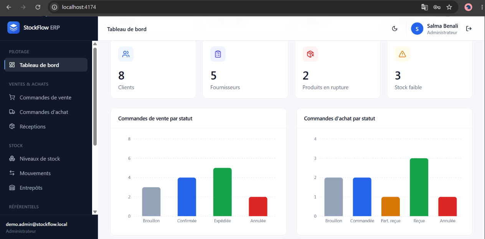](https://drive.google.com/file/d/1lUjrBOivsA23_V6KQpWw8w9t4PgVNBxO/view?usp=sharing)


</div>

---

## 🎯 En 30 secondes

StockFlow ERP couvre le cycle complet d'une petite entreprise de négoce :
**acheter → recevoir → stocker → vendre → expédier**, avec un **journal d'audit** de chaque action.

Ce projet met l'accent sur ce qui compte en production :

- **Intégrité du stock** : verrous de base de données (`select_for_update`), réservations, impossible de vendre plus que le disponible.
- **Réceptions idempotentes** : rejouer la même requête ne double pas le stock.
- **Permissions par rôle** (5 rôles), appliquées côté API **et** côté interface.
- **Qualité** : 183 tests backend (dont tests de concurrence), tests front, lint, CI GitHub Actions.

## ✨ Fonctionnalités

| Domaine | Ce que fait l'application |
|---|---|
| 🔐 Authentification | Connexion JWT (access 15 min, refresh 1 jour avec rotation et blacklist), déconnexion |
| 📦 Catalogue | Produits (SKU unique insensible à la casse), catégories, seuil de réapprovisionnement |
| 🏭 Stock | Entrepôts, niveaux de stock (en main / réservé / disponible), mouvements, ajustements |
| 🛒 Ventes | Commandes clients : Brouillon → Confirmée (réserve le stock) → Expédiée, ou Annulée |
| 🚚 Achats | Commandes fournisseurs : Brouillon → Commandée → Partiellement reçue → Reçue, ou Annulée |
| 📥 Réceptions | Réception partielle ou totale, clé d'idempotence, refus de sur-réception |
| 👥 Partenaires | Clients et fournisseurs |
| 🧾 Audit | Journal en lecture seule de toutes les actions métier (admin) |
| 📊 Tableau de bord | KPI, ruptures, stocks faibles, commandes par statut |
| 📚 API documentée | Swagger UI et ReDoc générés (drf-spectacular) |

## 📸 Aperçu

| | |
|:--:|:--:|
| 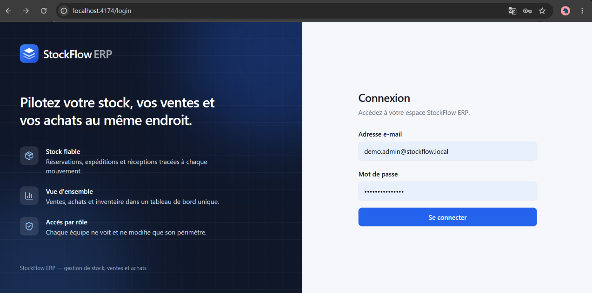<br>**Connexion** | 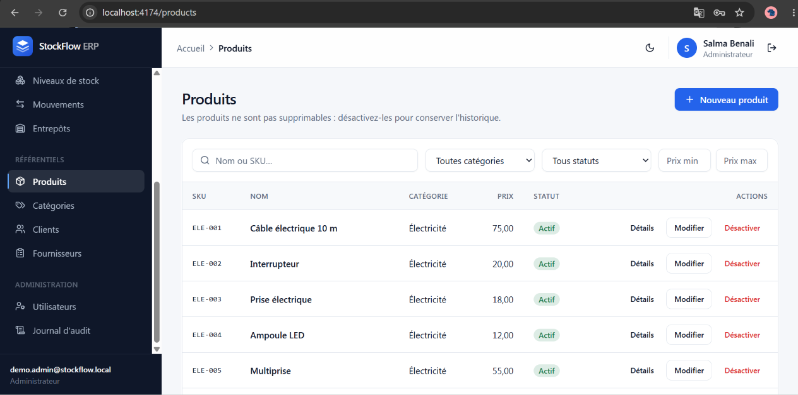<br>**Catalogue produits** |
| 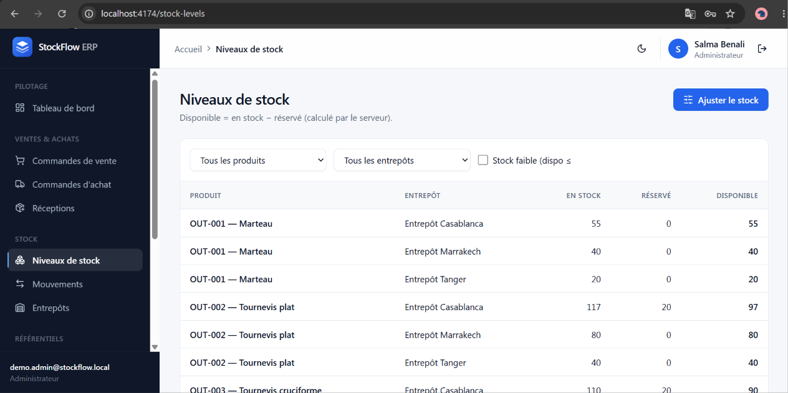<br>**Niveaux de stock** | 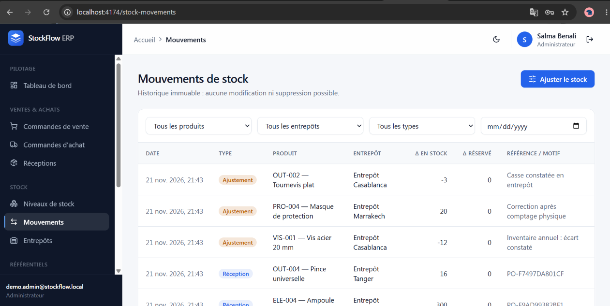<br>**Traçabilité des mouvements** |
| 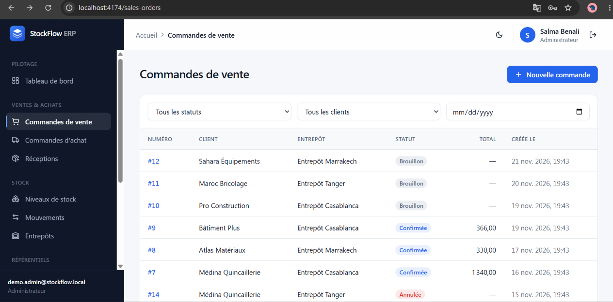<br>**Commandes de vente** | 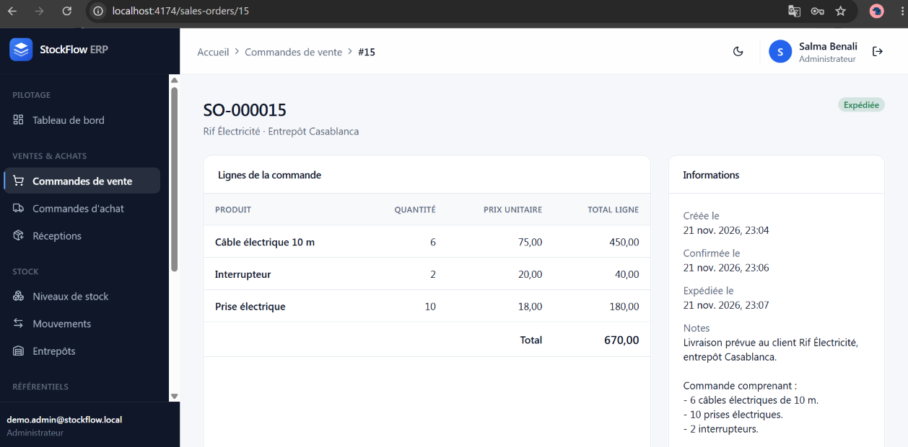<br>**Détail d'une commande de vente** |
| 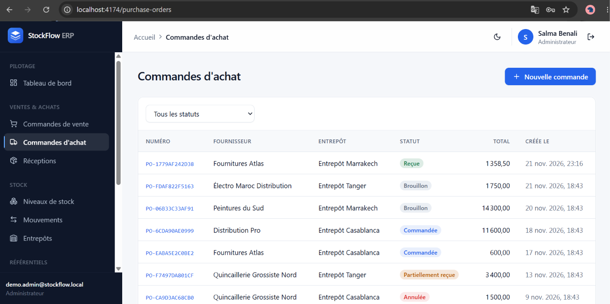<br>**Commandes d'achat** | 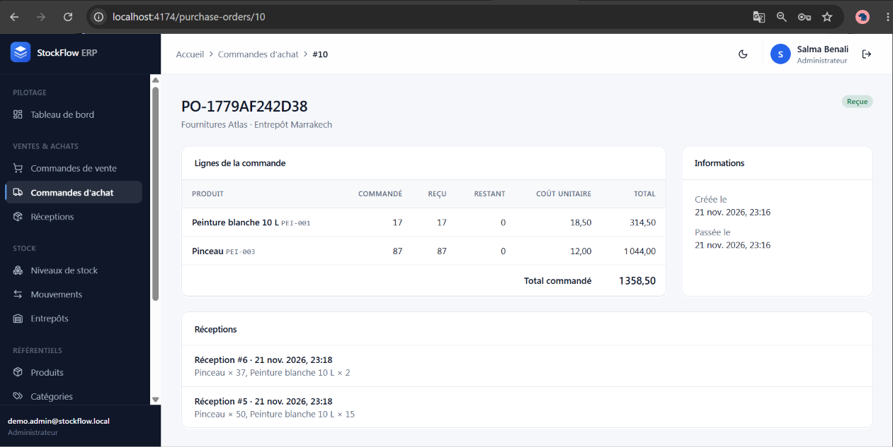<br>**Détail et réception d'achat** |
| 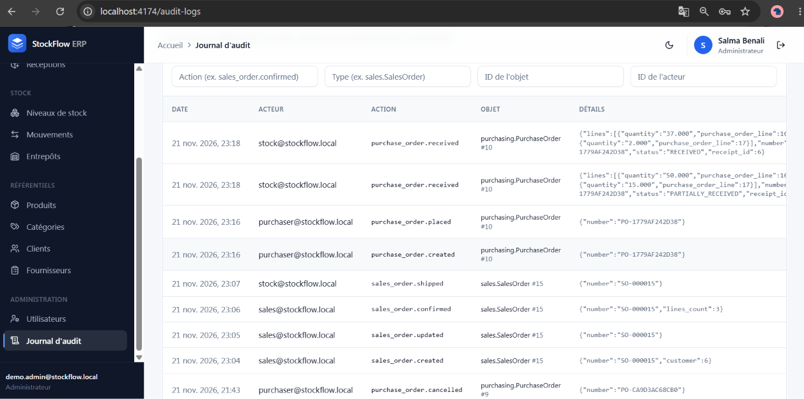<br>**Journal d'audit** | 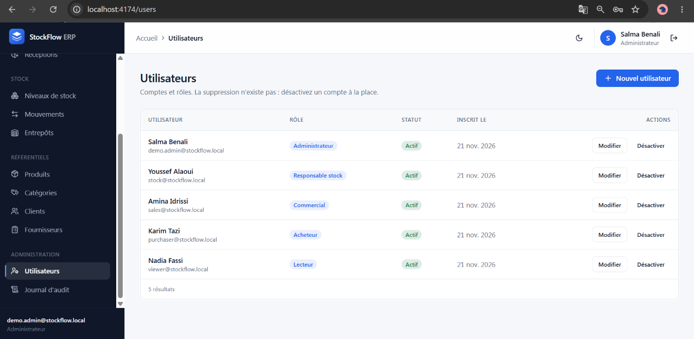<br>**Gestion des utilisateurs** |

## 🧰 Stack technique

| Couche | Technologies |
|---|---|
| Backend | Python 3.12, Django 5.2, Django REST Framework, SimpleJWT, django-filter, drf-spectacular |
| Base de données | PostgreSQL 16 |
| Frontend | React 18, TypeScript, Vite, Tailwind CSS, TanStack Query, React Hook Form, Zod, Recharts |
| Qualité | pytest (+ cov, factory-boy), Ruff, Vitest, Testing Library, MSW, ESLint |
| DevOps | Docker / Docker Compose, GitHub Actions, Gunicorn + WhiteNoise (prod) |

## 🚀 Démarrage rapide

**Prérequis :** [Docker Desktop](https://www.docker.com/products/docker-desktop/) et [Node.js 20+](https://nodejs.org/).

```bash
# 1. Cloner
git clone https://github.com/chaimaaelaffas1/stockflow-erp.git
cd stockflow-erp

# 2. Configurer (puis remplacer SECRET_KEY, voir docs/installation.md)
cp .env.example .env            # Windows PowerShell : Copy-Item .env.example .env

# 3. Lancer l'API + PostgreSQL
docker compose up -d --build
docker compose exec api python manage.py migrate

# 4. Charger des données de démonstration (5 comptes, un par rôle)
docker compose exec api python manage.py seed_demo --full --password "MotDePasse#2026"

# 5. Lancer l'interface
cd frontend && npm install && npm run dev
```

Ouvrez **http://localhost:5173** et connectez-vous :

| Rôle | E-mail | Mot de passe |
|---|---|---|
| Administrateur | `demo.admin@stockflow.local` | `MotDePasse#2026` |
| Responsable stock | `stock@stockflow.local` | `MotDePasse#2026` |
| Commercial | `sales@stockflow.local` | `MotDePasse#2026` |
| Acheteur | `purchaser@stockflow.local` | `MotDePasse#2026` |
| Lecteur | `viewer@stockflow.local` | `MotDePasse#2026` |

> 💡 Comptes de démonstration locaux uniquement. Changez-les pour tout autre usage.

| Service | URL |
|---|---|
| Interface web | http://localhost:5173 |
| API | http://localhost:8000/api/v1/ |
| Swagger UI | http://localhost:8000/api/schema/swagger-ui/ |
| ReDoc | http://localhost:8000/api/schema/redoc/ |
| Santé | http://localhost:8000/api/v1/health/ |

Un souci ? Voir [docs/installation.md](docs/installation.md#dépannage).

## 🧪 Tests

```bash
docker compose exec api pytest        # 183 tests backend
cd frontend && npm test               # tests front (Vitest)
```

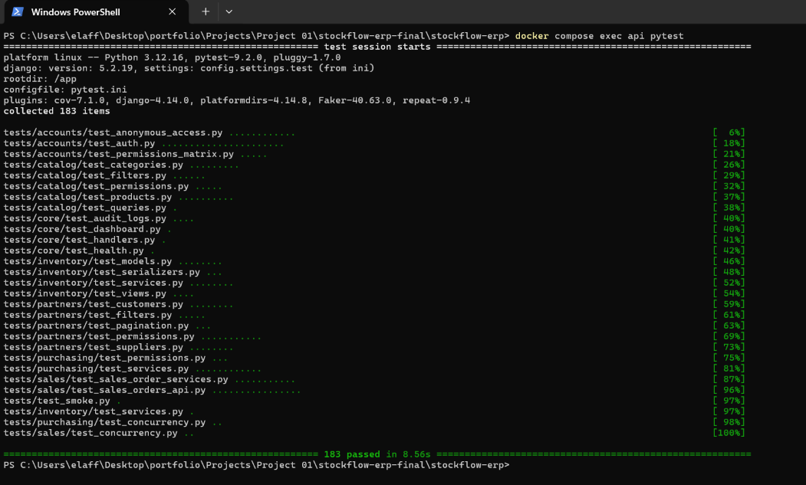

Détails : [docs/testing.md](docs/testing.md).

## 🏗️ Architecture en bref

```
stockflow-erp/
├── apps/
│   ├── accounts/    # utilisateurs, rôles, JWT
│   ├── catalog/     # catégories, produits
│   ├── inventory/   # entrepôts, stock, mouvements (services transactionnels)
│   ├── partners/    # clients, fournisseurs
│   ├── sales/       # commandes de vente (services : confirmer, expédier, annuler)
│   ├── purchasing/  # commandes d'achat, réceptions idempotentes
│   └── core/        # audit, dashboard, erreurs, pagination, seed_demo
├── config/          # settings (base / dev / test / prod), urls
├── tests/           # tests backend par domaine
├── frontend/        # React + TypeScript (features/, api/, components/, lib/)
├── docker-compose.yml · Dockerfile · .github/workflows/ci.yml
└── docs/
```

La logique métier vit dans des **services** (`services.py`), pas dans les vues : chaque opération de stock est transactionnelle, verrouillée et tracée. Voir [docs/architecture.md](docs/architecture.md).

## 📖 Documentation

| Document | Contenu |
|---|---|
| [docs/installation.md](docs/installation.md) | Installation Docker et locale, variables d'environnement, dépannage |
| [docs/architecture.md](docs/architecture.md) | Architecture, modèle de données, règles métier, décisions techniques |
| [docs/roles-permissions.md](docs/roles-permissions.md) | Matrice des rôles et permissions |
| [docs/api.md](docs/api.md) | Endpoints, authentification, format des erreurs |
| [docs/testing.md](docs/testing.md) | Stratégie de tests, CI |
| [docs/deployment.md](docs/deployment.md) | Image de production et variables |
| [docs/demo-video-script.md](docs/demo-video-script.md) | Parcours de démonstration |

## 🗺️ Pistes d'évolution

- Export CSV/PDF des commandes
- Notifications de stock faible
- Gestion multi-devises et taxes

## 📬 Contact

**Chaimaa El Affas**
✉️ [chaimaa.elaffas1@gmail.com](mailto:chaimaa.elaffas1@gmail.com)

---

<div align="center">Projet personnel réalisé dans une démarche de portfolio.</div>
