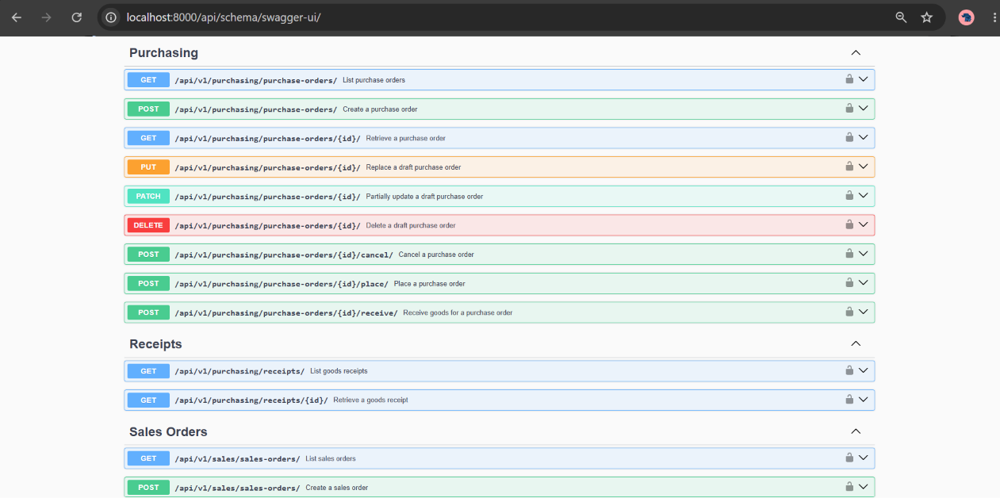

# API

Base : `http://localhost:8000/api/v1/` · Documentation interactive : [Swagger UI](http://localhost:8000/api/schema/swagger-ui/) · [ReDoc](http://localhost:8000/api/schema/redoc/) · Schéma OpenAPI : `/api/schema/`



## Authentification (JWT)

```bash
# 1. Obtenir les jetons
curl -X POST http://localhost:8000/api/v1/auth/token/ \
  -H "Content-Type: application/json" \
  -d '{"email":"demo.admin@stockflow.local","password":"MotDePasse#2026"}'

# 2. Appeler l'API
curl http://localhost:8000/api/v1/catalog/products/ \
  -H "Authorization: Bearer <access_token>"
```

| Méthode | Endpoint | Rôle |
|---|---|---|
| POST | `/auth/token/` | Connexion, renvoie `access` et `refresh` |
| POST | `/auth/token/refresh/` | Renouvelle l'access token (rotation du refresh) |
| POST | `/auth/logout/` | Invalide le refresh token |
| GET | `/auth/me/` | Profil de l'utilisateur connecté |

Durées : access 15 minutes, refresh 1 jour.

## Ressources

Toutes les listes sont paginées : `?page=2&page_size=50` (20 par défaut, 100 maximum).

| Domaine | Endpoint | Remarque |
|---|---|---|
| Utilisateurs | `/users/` | Admin uniquement |
| Clients | `/partners/customers/` | |
| Fournisseurs | `/partners/suppliers/` | |
| Catégories | `/catalog/categories/` | |
| Produits | `/catalog/products/` | Filtres via django-filter |
| Entrepôts | `/inventory/warehouses/` | |
| Niveaux de stock | `/inventory/stock-levels/` | Lecture |
| Mouvements | `/inventory/stock-movements/` | Lecture |
| Ajustement | `POST /inventory/stock-adjustments/` | Corrige le stock avec un motif |
| Commandes de vente | `/sales/sales-orders/` | Actions ci-dessous |
| Commandes d'achat | `/purchasing/purchase-orders/` | Actions ci-dessous |
| Réceptions | `/purchasing/receipts/` | Lecture |
| Tableau de bord | `GET /dashboard/summary/` | KPI |
| Audit | `GET /dashboard/audit-logs/` | Admin, lecture seule |
| Santé | `GET /health/` | Sans authentification |

### Actions métier

| Endpoint | Effet |
|---|---|
| `POST /sales/sales-orders/{id}/confirm/` | Réserve le stock |
| `POST /sales/sales-orders/{id}/ship/` | Expédie |
| `POST /sales/sales-orders/{id}/cancel/` | Annule |
| `POST /purchasing/purchase-orders/{id}/place/` | Passe la commande au fournisseur |
| `POST /purchasing/purchase-orders/{id}/receive/` | Réceptionne (avec `idempotency_key`) |
| `POST /purchasing/purchase-orders/{id}/cancel/` | Annule |

Exemple de réception :

```json
POST /api/v1/purchasing/purchase-orders/1/receive/
{
  "idempotency_key": "3f2b8c1e-5d4a-4e7b-9a6c-1b2d3e4f5a6b",
  "lines": [{ "purchase_order_line": 1, "quantity": "2.000" }]
}
```

## Erreurs

Format unique :

```json
{ "error": { "code": "over_receipt", "message": "...", "details": { } } }
```

| HTTP | Code | Quand |
|---|---|---|
| 400 | `validation_error` | Données invalides |
| 401 | | Jeton absent ou expiré |
| 403 | | Rôle insuffisant |
| 409 | `insufficient_stock` | Stock disponible insuffisant |
| 409 | `over_receipt` | Quantité reçue supérieure au reste à recevoir |
| 409 | `idempotency_conflict` | Clé déjà utilisée avec un autre contenu |

> Vérifiez les champs exacts dans Swagger : c'est la référence.
