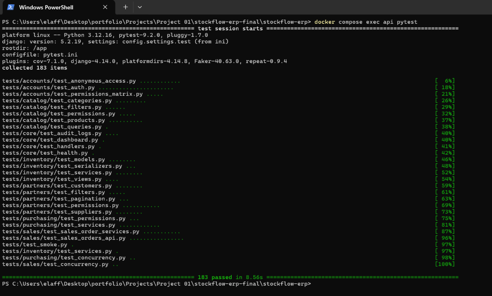

# Tests et qualité



## Backend : 183 tests

```bash
docker compose exec api pytest                          # tous les tests
docker compose exec api pytest tests/sales              # un domaine
docker compose exec api pytest --cov=apps --cov-report=term-missing
docker compose exec api pytest -m slow                  # tests de concurrence
```

Les tests utilisent `config.settings.test` et PostgreSQL.

| Dossier | Ce qui est vérifié |
|---|---|
| `tests/accounts` | Authentification, accès anonyme, matrice de permissions |
| `tests/catalog`, `tests/partners` | CRUD, filtres, pagination, permissions |
| `tests/inventory` | Modèles, services, sérialiseurs, vues |
| `tests/sales`, `tests/purchasing` | Services métier, API, **concurrence** |
| `tests/core` | Audit, dashboard, gestion d'erreurs, santé |

Les tests de concurrence lancent des opérations simultanées pour prouver qu'on ne peut pas vendre plus que le stock disponible.

## Frontend

```bash
cd frontend
npm test            # Vitest, API simulée avec MSW
npm run typecheck   # TypeScript
npm run lint        # ESLint
npm run build
```

## Lint Python

```bash
docker compose exec api ruff check .
docker compose exec api ruff format --check .
```

## Intégration continue

`.github/workflows/ci.yml` s'exécute à chaque push sur `main` et chaque pull request, avec PostgreSQL 16 :

1. Ruff (lint et format)
2. Contrôle des migrations (`makemigrations --check`)
3. `pytest`
4. Validation du schéma OpenAPI
